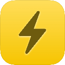

# Reeder Chrome Extension

<div align="center">



[](https://chrome.google.com/webstore/detail/kdmelpioblnhdphjcafpclindpmcjfgh)
[](https://chrome.google.com/webstore/detail/kdmelpioblnhdphjcafpclindpmcjfgh)
[](https://github.com/xMrPhede/Reeder-chrome-extension/blob/main/LICENSE)

</div>

---

## 📖 Overview

**Reeder Chrome Extension** lets you send the current webpage from your browser directly to the Reeder macOS app.
It integrates seamlessly with Reeder’s native share system through a lightweight local connector.

This project consists of two components:

1. **Browser Extension (for Chromium browsers)**
   Adds a toolbar button labeled **“Share to Reeder”** — clicking it sends the current page to your Reeder app.

2. **macOS Native Connector**
   A single Swift native-messaging binary (`macshare_host`) that allow the browser to communicate with Reeder through macOS’s Share Extension system.

---

## 🚀 Features

* One-click **“Share to Reeder”** button
* Automatic detection of the native connector
* Clear setup guide when the connector is missing
* Works with **Chrome**, **Edge**, **Brave**, **Vivaldi**, **Opera**, and **Arc**
* Secure native messaging bridge for macOS

---

## ⚙️ Setup

### 1. Install the Browser Extension

Install directly from the Chrome Web Store:

**[→ Install Reeder Chrome Extension](https://chrome.google.com/webstore/detail/kdmelpioblnhdphjcafpclindpmcjfgh)**

Once installed, pin the extension to your toolbar.
On first use, it will check whether the native connector is present and provide setup instructions if not.

---

### 2. Install the Native macOS Connector (automatic)

Run this command in your Mac Terminal:

```bash
curl -fsSL https://raw.githubusercontent.com/xMrPhede/Reeder-chrome-extension/main/install.sh | bash
```

Requires macOS, Reeder, and Xcode Command Line Tools (`xcode-select --install`).
The installer downloads the Swift source, compiles it without administrator privileges,
and installs it under `~/Library/Application Support/ReederChromeConnector/`.
It registers Chrome only by default and uses the Chrome Web Store extension ID.
Existing connector files and the selected browser's manifest are backed up before replacement.
Compilation failures leave the existing installation untouched.

Enable **Add to Reeder** in System Settings → General → Login Items & Extensions
(the location may vary by macOS version), then open the browser extension.
Only HTTP and HTTPS webpages can be shared.

### Install from a local checkout or choose another browser

```bash
git clone https://github.com/xMrPhede/Reeder-chrome-extension.git
cd Reeder-chrome-extension
bash install.sh --source-dir .
# For another browser, run again with one of:
bash install.sh --source-dir . --browser brave
bash install.sh --source-dir . --browser edge
```

Supported browser names are `chrome`, `brave`, `edge`, `vivaldi`, `arc`,
`chromium`, and `opera`. Each run registers only the chosen browser.
Chrome has been tested end to end; other browsers' registration paths still
need verification on their respective installations.

For an unpacked extension, add `--extension-id YOUR_EXTENSION_ID`, using the
32-character ID shown on the browser's extensions page. Generated manifests
contain an absolute binary path and an exact `chrome-extension://ID/` allowlist;
no placeholder editing or `edge-extension://` origin is needed.
The root `com.reeder.macshare.json` is a legacy system-path example; use the
installer to generate the correct manifest for your account.

The downloaded installer obtains source from `main`. To inspect the code first,
use a local checkout and `--source-dir .`; you can check out a specific commit
before running it.

---

## 🧩 How It Works

1. The extension sends the current tab’s URL to the native host `com.reeder.macshare`.
2. The Swift host (`macshare_host`) validates the URL and the native-message framing.
3. The host triggers macOS’s Reeder Share Extension and waits for its completion callback.
4. Reeder saves the page to your reading list (local or iCloud).

---

## ❌ Uninstallation

Move the following to the macOS Trash:

* `~/Library/Application Support/ReederChromeConnector/`
* `com.reeder.macshare.json` inside the `NativeMessagingHosts` folder for each
  browser you registered (Chrome: `~/Library/Application Support/Google/Chrome/NativeMessagingHosts/`).

If you used the old installer, `/usr/local/bin/macshare` and
`/usr/local/bin/macshare_host` may also remain and can be removed separately.

Then remove the extension from your browser as usual.

---

## 📝 License

This project is licensed under the **MIT License**.
See the [LICENSE](LICENSE) file for details.

---

<div align="center">

Made with ❤️ by Federico Granata

</div>
